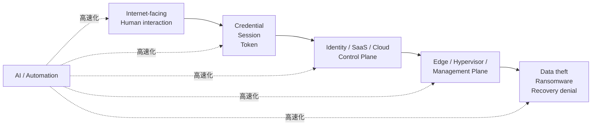
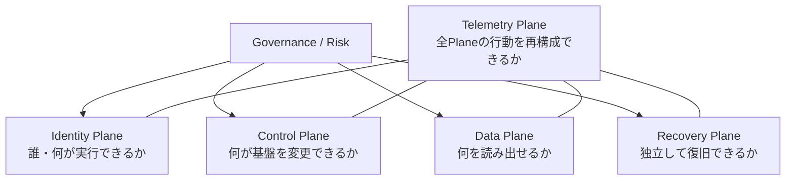

# Tech Landscape 2026

English version: [README.md](README.md)

> その年の主要なセキュリティ／AIレポート、カンファレンスの信号、技術リサーチを集め、Cloud / Identity / SecOps / DevSecOps / Recovery / AIを含むEnterprise Architectureのリファレンスへ落とし込む、継続更新型の記録。

このリポジトリはセキュリティ専用のランドスケープとして始まりましたが、現在はAIの話題、カンファレンスレポート、その他の技術レポートも扱っています。そのため索引は**月別（時系列）**と**テーマ別**の2通りでたどれるようにしています。

## まずここから

- **月ごとに何が入ったか** → [時系列](#時系列タイムライン)
- **テーマで読みたい** → [テーマ別に探す](#テーマ別に探す)
- **全体として何が言えるか** → [2026年の中心命題](#2026年の中心命題)、[設計モデル](#設計モデル)、[横断分析](analysis/cross-report-trends.md)

## 時系列（タイムライン）

新しい順。日付は各ソースの**公開日**（レポート）または**開催日**（カンファレンス）で、各ノートのフロントマターから取っています。公開日と観測期間は別物です。注意点は [analysis/trend-timeline.md](analysis/trend-timeline.md) を参照してください。

### 2026-09

- 2026-09-22 — [ENISA Threat Landscape 2026](reports/07-enisa-threat-landscape-2026.ja.md)（[EN](reports/07-enisa-threat-landscape-2026.md)）— EU全体の脅威動向 · セキュリティレポート
- 2026-09-22 — [Akamai SOTI 2026 — Agentic Threat Landscape](supplemental/06-akamai-agentic-threat-landscape-2026.ja.md)（[EN](supplemental/06-akamai-agentic-threat-landscape-2026.md)）— AIエージェント / MCP / 非人間アイデンティティ · AI＋セキュリティ
- 2026-09-30 — [日本の能動的サイバー防御：2026年10月1日の施行範囲と実務上の論点](supplemental/09-japan-active-cyber-defense-2026.ja.md)（[EN](supplemental/09-japan-active-cyber-defense-2026.md)）— 日本の政策 / 重要インフラ · ポリシー

### 2026-08

- 2026-08-01→06 — [Black Hat USA 2026](conferences/02-black-hat-usa-2026.md) — カンファレンス（英語のみ）
- 2026-08-06→09 — [DEF CON 34](conferences/03-def-con-34.md) — カンファレンス（英語のみ）
- 2026-08-11 — [Cloudflare DDoS Threat Report H1 2026](supplemental/04-cloudflare-ddos-h1-2026.ja.md)（[EN](supplemental/04-cloudflare-ddos-h1-2026.md)）— 可用性 / DNS / 大規模DDoS · セキュリティレポート

### 2026-06

- 2026-06-14→19 — [FIRSTCON26](conferences/05-firstcon26.md) — カンファレンス（英語のみ）

### 2026-05

- 2026-05-18 — [Verizon 2026 Data Breach Investigations Report](reports/02-verizon-dbir-2026.ja.md)（[EN](reports/02-verizon-dbir-2026.md)）— 侵害統計の基礎データ · セキュリティレポート

### 2026-04

- 2026-04-21→23 — [FIRST Cyber Threat Intelligence Conference 2026](conferences/04-first-cti-2026.md) — カンファレンス（英語のみ）

### 2026-03

- 2026-03-03 — [Cloudflare 2026 Threat Report](supplemental/03-cloudflare-threat-report-2026.ja.md)（[EN](supplemental/03-cloudflare-threat-report-2026.md)）— SaaS / トークン窃取 / DDoS · セキュリティレポート
- 2026-03-10 — [Google Cloud Threat Horizons H1 2026](supplemental/01-google-cloud-threat-horizons-h1-2026.ja.md)（[EN](supplemental/01-google-cloud-threat-horizons-h1-2026.md)）— Cloud / CI/CD / フォレンジック準備 · セキュリティレポート
- 2026-03-17 — [Akamai SOTI 2026 — Apps, APIs, AI and DDoS](supplemental/05-akamai-app-api-ddos-2026.ja.md)（[EN](supplemental/05-akamai-app-api-ddos-2026.md)）— API / アプリ / AIコーディング · セキュリティ＋AI
- 2026-03-23 — [Mandiant M-Trends 2026](reports/01-m-trends-2026.ja.md)（[EN](reports/01-m-trends-2026.md)）— 最前線のインシデント対応エビデンス · セキュリティレポート
- 2026-03-23→26 — [RSAC 2026](conferences/01-rsac-2026.md) — カンファレンス（英語のみ）

### 2026-02

- 2026-02-17 — [Unit 42 Global Incident Response Report 2026](reports/04-unit42-global-ir-2026.ja.md)（[EN](reports/04-unit42-global-ir-2026.md)）— インシデント対応 · セキュリティレポート
- 2026-02-24 — [CrowdStrike 2026 Global Threat Report](reports/03-crowdstrike-global-threat-report-2026.ja.md)（[EN](reports/03-crowdstrike-global-threat-report-2026.md)）— 攻撃者オペレーション · セキュリティレポート
- 2026-02-24 — [Sophos Active Adversary Report 2026](supplemental/02-sophos-active-adversary-2026.ja.md)（[EN](supplemental/02-sophos-active-adversary-2026.md)）— Identity / IR / ログ保持 · セキュリティレポート
- 2026-02-25 — [IBM X-Force Threat Intelligence Index 2026](reports/06-ibm-xforce-2026.ja.md)（[EN](reports/06-ibm-xforce-2026.md)）— 脅威インテリジェンス指標 · セキュリティレポート

### 2026-01

- 2026-01-28 — [Check Point Cyber Security Report 2026](supplemental/07-check-point-cyber-security-report-2026.ja.md)（[EN](supplemental/07-check-point-cyber-security-report-2026.md)）— AI / MCP / エッジの攻撃経路 · セキュリティ＋AI

### 2025-10

- 2025-10-16 — [Microsoft Digital Defense Report 2025](reports/05-microsoft-digital-defense-report-2025.ja.md)（[EN](reports/05-microsoft-digital-defense-report-2025.md)）— Identity / Cloud / AIのテレメトリ · セキュリティレポート（2026-09-26時点の最新年次版）

### 2026年（月は出典ノートに未記録）

- [Fortinet 2026 Global Threat Landscape Report](supplemental/08-fortinet-global-threat-landscape-2026.ja.md)（[EN](supplemental/08-fortinet-global-threat-landscape-2026.md)）— エクスプロイト速度 / ネットワーク · セキュリティレポート ※フロントマターは年のみ。引用前にFortinet公式ページで公開月を確認すること

## テーマ別に探す

### セキュリティレポート

- 主要年次レポート（日英・詳細ノート）: [reports/](reports/README.md) — M-Trends、DBIR、CrowdStrike、Unit 42、Microsoft MDDR、IBM X-Force、ENISA
- 補完リサーチ（日英）: [supplemental/](supplemental/README.md) — Google Cloud、Sophos、Cloudflare、Akamai、Check Point、Fortinet、日本の能動的サイバー防御
- 出典レジストリ全体: [SOURCES.md](SOURCES.md)

### AI

- [AI Security Architecture](ai-security/README.md)
- [AI Agent Security](ai-security/agent-security.md)
- [MCP Security](ai-security/mcp-security.md)
- タイムライン内のAI関連エビデンス: Akamai Agentic Threat Landscape（2026-09）、Akamai Apps/APIs/AI（2026-03）、Check Point（2026-01）

### カンファレンス

- [RSAC 2026](conferences/01-rsac-2026.md) · [Black Hat USA 2026](conferences/02-black-hat-usa-2026.md) · [DEF CON 34](conferences/03-def-con-34.md) · [FIRST CTI 2026](conferences/04-first-cti-2026.md) · [FIRSTCON26](conferences/05-firstcon26.md) — 現在は英語のみ

### アーキテクチャとフレームワーク

- [Reference Architecture](architecture/reference-architecture.md) · [Security Planes](architecture/security-planes.md) · [Identity](architecture/identity.md) · [Recovery](architecture/recovery.md) · [Azure / AWS / GCP Control Mapping](architecture/cloud-controls.md) · [Telemetry](architecture/telemetry.md)
- フレームワーク対応表: [MITRE ATT&CK](frameworks/mitre-attack.md) · [NIST CSF 2.0](frameworks/nist-csf.md) · [CIS Controls v8.1](frameworks/cis-controls.md) · [NIST × CIS × 2026 Threat Crosswalk](frameworks/nist-cis-crosswalk.md)

### 横断分析と運用

- [Cross-report Consensus Matrix](analysis/cross-report-trends.md) · [Attack Paths](analysis/attack-paths.md) · [Research Timeline（分析ビュー）](analysis/trend-timeline.md) · [Enterprise Architectureへの示唆](analysis/enterprise-architecture-implications.md) · [Enterprise Architect Perspective](analysis/enterprise-architect-perspective.md)
- [Detection Engineering](operations/detection-engineering.md) · [2026 Security Priorities](operations/security-priorities.md)
- 出典変更モニター: [monitor/](monitor/README.md)

## このリポジトリの目的

一般的な脅威レポート要約は「何が起きたか」で終わりがちです。このリポジトリでは、さらに次を扱います。

- 独立した複数ソースで繰り返される傾向は何か
- どのAttack Pathが構造的に重要になっているか
- 何をTier-0相当のSecurity Planeとして設計すべきか
- MITRE ATT&CK / NIST CSF 2.0 / CIS Controls v8.1へどう対応するか
- Azure / AWS / GCP / SaaS / CI/CD / AI Agentで何を実装すべきか
- Machine-speed attackへ対応するため、どのTelemetryとDetectionが必要か

ベンダーの優劣比較ではなく、**複数の観測結果をEnterprise Architectureへ変換すること**が目的です。視点は **Enterprise IT × Cloud × Security × DevSecOps × Operations** を横断するゼネラリスト・アーキテクトです。

## 2026年の中心命題

2026年の変化は「AIが従来型攻撃を置き換えた」ことではありません。むしろ、**すでに有効だったAttack Pathの各段階をAIと自動化が高速・大規模化している**ことです。

横断すると特に重要なのは次の7点です。

1. **Identityが実質的なPerimeterになった。** 人間だけでなく、Service Account、OAuth Grant、Session Token、API Key、AI Agentまで攻撃面。
2. **Internet-facing / Edgeが主要入口。** VPN、Firewall、Web Asset、Network Appliance、Management Interfaceが重要。
3. **Cloud / SaaS / Supply Chainが一体化。** Trusted IntegrationやDelegated Accessが横展開経路になる。
4. **攻撃速度が圧縮されている。** 高確度イベントを人間だけで処理するSOCモデルでは間に合わないケースが増える。
5. **RecoveryはSecurity Plane。** Backupが存在することと、IdentityやHypervisorまで侵害された状態から復旧できることは別。
6. **製品数よりTelemetry Coverage。** IdP、Cloud Control Plane、SaaS、Edge、Hypervisor、Backup、CI/CD、AI Toolを横断して観測できることが重要。
7. **AI SecurityはIdentity / Authorization Engineeringへ。** モデル選定より、Agent Identity、Tool Permission、Token、Audit、Human Approval Boundaryが基礎になる。

## 設計モデル

2026年を一言で表すなら、

> **Endpoint Securityの延長として考えるのではなく、Identity、Cloud/SaaS Control Plane、Edge/Virtualization、Recovery、Privileged AI Agentを独立したSecurity Boundaryとして再設計する。**

ということです。

## Evidenceの扱い

- **Major** — レポートの主要テーマ・主要発見
- **Observed** — 明確な観測はあるが中心テーマではない
- **Not emphasized** — 今回確認した範囲では主要論点ではない

各ベンダーの母集団・地域・Incident Definitionが異なるため、統計値そのものをベンダー間ランキングには使いません。

## スコープと方法論

- 横断分析セクションのエビデンス・スナップショット: **2026-09-26（JST）**（タイムライン側はその後の追加を個別に追跡）
- 一次情報・公式ソースを優先します。
- 重要な統計は、各レポートノート内で出典とObservation Periodとセットで記録します。
- 横断結論には、複数ソースでの反復か、明示的な分析根拠が必要です。
- カンファレンスノートは公式プログラム・総括・代表的セッションの要約であり、全講演の逐語記録ではありません。
- フレームワーク対応付けはアーキテクチャ上のクロスウォークであり、出典レポート自身がそのフレームワークを使ったという主張ではありません。
- 詳細は [SOURCES.md](SOURCES.md)（出典レジストリ）、[CONTRIBUTING.md](CONTRIBUTING.md)（更新手順）を参照してください。

## メンテナンス

このリポジトリは一回限りの要約ではなく再現可能な記録として維持し、**Living Architecture Reference**として育てます。更新は定期更新より「重要な変化があった時」を優先します。

### 次にアップデートする時期

次回のおすすめ確認時期：**2026年10月末〜11月**。以下のいずれかが発生したら部分更新します。

- Microsoftが次のDigital Defense Report年次版を公開した
- 主要Vendorが2026年版Threat / Incident Response Reportを大きく更新した
- Black Hat / DEF CON / FIRSTなどの追加公開資料で、現在のArchitecture結論を変える重要な研究が出た
- MITRE ATT&CK / NIST CSF / CIS Controls / MCP / Cloud ProviderのSecurity Guidanceに、現在のMappingへ影響する変更が入った

大きなTriggerがなければ、**2026年12月〜2027年1月**に年末レビューを行い、2026年版を一度締めます。

### 次の大規模更新：2027年2月〜5月

2027年版の主要年次レポートが出始めた段階で本格更新します。

1. 2027 Editionを追加する
2. 2026 Editionは履歴として残す
3. **2026 → 2027で何が変わったか**を新しく分析する
4. Consensus MatrixとArchitecture ImplicationをEvidenceが変わった部分だけ更新する
5. 現在のSecurity Plane Modelが引き続き有効か再評価する

### バックログ

1. **2026年末の総括を追加する** — さらに強まったTrend／年初から変わらなかったTrend／話題ほどEnterprise Architectureへ影響しなかったTrendを分けて整理する。
2. **2026 → 2027 Delta Analysisを作る** — Initial Access、Identity Abuse、Cloud / SaaS、Edge / Virtualization、Ransomware / Recovery Denial、AI Attack / AI Defense、Attack / Response Speedの前年変化を追えるようにする。
3. **Conference資料も日本語版を追加する** — RSAC / Black Hat / DEF CON / FIRST CTI / FIRSTCONを `reports/` と同じ日英ペア構成にする。
4. **Source Update Monitoring — 実装済み** — 月1回、主要な公式Landing Pageを確認し、新EditionのMarkerを検知したらGitHub Issueを自動作成する [Source Monitor](monitor/README.md)。FrameworkやCloud Security Guidanceも必要に応じてRegistryへ追加する。
5. **CHANGELOG / Release Tagを導入する** — `2026-09-snapshot`、`2026-year-end`、`2027-q1-refresh` のようなTag / Releaseで、どの時点の知見か追いやすくする。
6. **Architectureは流行ではなくEvidenceで変える** — 複数の独立したSourceや重要な技術変化が裏付けた時だけArchitectureを変更する。

### 更新時チェックリスト

- [ ] Core 7レポートに新版が出ていないか確認
- [ ] Supplemental ReportのSource Monitor結果を確認
- [ ] Conferenceの追加公開資料・研究を確認
- [ ] 重要統計とObservation Periodを再確認
- [ ] 英語版と日本語版を同時に更新
- [ ] 上の[時系列（タイムライン）](#時系列タイムライン)と該当セクションの索引へ追加
- [ ] [SOURCES.md](SOURCES.md) を更新
- [ ] Cross-report Consensus Matrixを再評価
- [ ] MITRE ATT&CK / NIST / CIS Mappingを確認
- [ ] Azure / AWS / GCPの実装Referenceを確認
- [ ] AI Agent / MCP Security Guidanceを確認
- [ ] Link Check CIを実行
- [ ] CHANGELOG / Release Noteへ変更内容を記録
