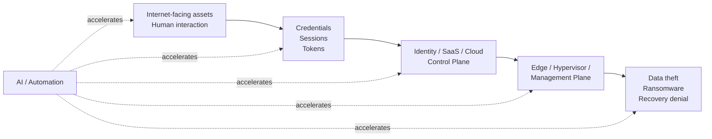
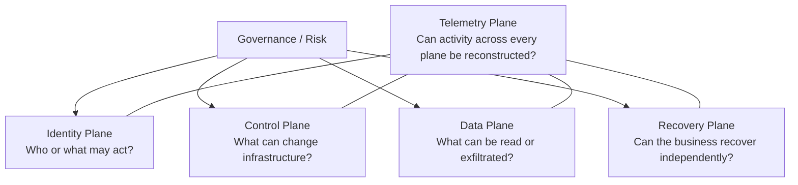

# Tech Landscape 2026

日本語版: [README.ja.md](README.ja.md)

> A living reference that collects the year's major security and AI reports, conference signals, and technology research — and translates them into an Enterprise Architecture reference for Cloud, Identity, SecOps, DevSecOps, Recovery, and AI systems.

This repository started as a security-only landscape. It now also tracks AI topics, conference reports, and broader technology research, so the index below is organised **by month** and **by topic** to make growth easy to follow.

## Start here

- **What arrived, month by month** → [Timeline](#timeline)
- **Reading by theme** → [Browse by topic](#browse-by-topic)
- **What it all means** → [2026 thesis](#2026-thesis), [Architecture model](#architecture-model), and the [cross-source analysis](analysis/cross-report-trends.md)

## Timeline

Newest first. Dates are each source's **publication date** (reports) or **event dates** (conferences), taken from the notes' own frontmatter. Publication date is not the observation period — see the warning in [analysis/trend-timeline.md](analysis/trend-timeline.md).

### 2026-09

- 2026-09-22 — [ENISA Threat Landscape 2026](reports/07-enisa-threat-landscape-2026.md) ([JA](reports/07-enisa-threat-landscape-2026.ja.md)) — EU-wide threat landscape · Security report
- 2026-09-22 — [Akamai SOTI 2026 — Agentic Threat Landscape](supplemental/06-akamai-agentic-threat-landscape-2026.md) ([JA](supplemental/06-akamai-agentic-threat-landscape-2026.ja.md)) — AI agents / MCP / nonhuman identity · AI + Security
- 2026-09-30 — [Japan active cyber defense: October 2026 commencement](supplemental/09-japan-active-cyber-defense-2026.md) ([JA](supplemental/09-japan-active-cyber-defense-2026.ja.md)) — Japan policy / critical infrastructure · Policy

### 2026-08

- 2026-08-01→06 — [Black Hat USA 2026](conferences/02-black-hat-usa-2026.md) — Conference (EN only)
- 2026-08-06→09 — [DEF CON 34](conferences/03-def-con-34.md) — Conference (EN only)
- 2026-08-11 — [Cloudflare DDoS Threat Report H1 2026](supplemental/04-cloudflare-ddos-h1-2026.md) ([JA](supplemental/04-cloudflare-ddos-h1-2026.ja.md)) — Availability / DNS / hyper-volumetric DDoS · Security report

### 2026-06

- 2026-06-14→19 — [FIRSTCON26](conferences/05-firstcon26.md) — Conference (EN only)

### 2026-05

- 2026-05-18 — [Verizon 2026 Data Breach Investigations Report](reports/02-verizon-dbir-2026.md) ([JA](reports/02-verizon-dbir-2026.ja.md)) — Breach statistics baseline · Security report

### 2026-04

- 2026-04-21→23 — [FIRST Cyber Threat Intelligence Conference 2026](conferences/04-first-cti-2026.md) — Conference (EN only)

### 2026-03

- 2026-03-03 — [Cloudflare 2026 Threat Report](supplemental/03-cloudflare-threat-report-2026.md) ([JA](supplemental/03-cloudflare-threat-report-2026.ja.md)) — SaaS / token theft / DDoS · Security report
- 2026-03-10 — [Google Cloud Threat Horizons H1 2026](supplemental/01-google-cloud-threat-horizons-h1-2026.md) ([JA](supplemental/01-google-cloud-threat-horizons-h1-2026.ja.md)) — Cloud / CI/CD / forensic readiness · Security report
- 2026-03-17 — [Akamai SOTI 2026 — Apps, APIs, AI and DDoS](supplemental/05-akamai-app-api-ddos-2026.md) ([JA](supplemental/05-akamai-app-api-ddos-2026.ja.md)) — API / app / AI coding · Security + AI
- 2026-03-23 — [Mandiant M-Trends 2026](reports/01-m-trends-2026.md) ([JA](reports/01-m-trends-2026.ja.md)) — Frontline incident-response evidence · Security report
- 2026-03-23→26 — [RSAC 2026](conferences/01-rsac-2026.md) — Conference (EN only)

### 2026-02

- 2026-02-17 — [Unit 42 Global Incident Response Report 2026](reports/04-unit42-global-ir-2026.md) ([JA](reports/04-unit42-global-ir-2026.ja.md)) — Incident response · Security report
- 2026-02-24 — [CrowdStrike 2026 Global Threat Report](reports/03-crowdstrike-global-threat-report-2026.md) ([JA](reports/03-crowdstrike-global-threat-report-2026.ja.md)) — Adversary operations · Security report
- 2026-02-24 — [Sophos Active Adversary Report 2026](supplemental/02-sophos-active-adversary-2026.md) ([JA](supplemental/02-sophos-active-adversary-2026.ja.md)) — Identity / IR / log retention · Security report
- 2026-02-25 — [IBM X-Force Threat Intelligence Index 2026](reports/06-ibm-xforce-2026.md) ([JA](reports/06-ibm-xforce-2026.ja.md)) — Threat intelligence index · Security report

### 2026-01

- 2026-01-28 — [Check Point Cyber Security Report 2026](supplemental/07-check-point-cyber-security-report-2026.md) ([JA](supplemental/07-check-point-cyber-security-report-2026.ja.md)) — AI / MCP / edge attack paths · Security + AI

### 2025-10

- 2025-10-16 — [Microsoft Digital Defense Report 2025](reports/05-microsoft-digital-defense-report-2025.md) ([JA](reports/05-microsoft-digital-defense-report-2025.ja.md)) — Identity / cloud / AI telemetry · Security report (latest annual edition available as of 2026-09-26)

### 2026 — month not recorded in the source note

- [Fortinet 2026 Global Threat Landscape Report](supplemental/08-fortinet-global-threat-landscape-2026.md) ([JA](supplemental/08-fortinet-global-threat-landscape-2026.ja.md)) — Exploit velocity / network · Security report *(frontmatter records only the year; verify the month against Fortinet's official page before citing)*

## Browse by topic

### Security reports

- Core annual reports (EN + JA, detailed notes): [reports/](reports/README.md) — M-Trends, DBIR, CrowdStrike, Unit 42, Microsoft MDDR, IBM X-Force, ENISA
- Supplemental research (EN + JA): [supplemental/](supplemental/README.md) — Google Cloud, Sophos, Cloudflare, Akamai, Check Point, Fortinet, Japan active cyber defense
- Full source register: [SOURCES.md](SOURCES.md)

### AI

- [AI Security Architecture](ai-security/README.md)
- [AI Agent security](ai-security/agent-security.md)
- [MCP security](ai-security/mcp-security.md)
- AI-related evidence in the timeline: Akamai Agentic Threat Landscape (2026-09), Akamai Apps/APIs/AI (2026-03), Check Point (2026-01)

### Conferences

- [RSAC 2026](conferences/01-rsac-2026.md) · [Black Hat USA 2026](conferences/02-black-hat-usa-2026.md) · [DEF CON 34](conferences/03-def-con-34.md) · [FIRST CTI 2026](conferences/04-first-cti-2026.md) · [FIRSTCON26](conferences/05-firstcon26.md) — English only for now

### Architecture and frameworks

- [Reference architecture](architecture/reference-architecture.md) · [Security planes](architecture/security-planes.md) · [Identity](architecture/identity.md) · [Recovery](architecture/recovery.md) · [Azure / AWS / GCP control mapping](architecture/cloud-controls.md) · [Telemetry](architecture/telemetry.md)
- Framework crosswalks: [MITRE ATT&CK](frameworks/mitre-attack.md) · [NIST CSF 2.0](frameworks/nist-csf.md) · [CIS Controls v8.1](frameworks/cis-controls.md) · [NIST × CIS × 2026 threats](frameworks/nist-cis-crosswalk.md)

### Analysis and operations

- [Cross-report consensus matrix](analysis/cross-report-trends.md) · [Attack paths](analysis/attack-paths.md) · [Research timeline (analytical view)](analysis/trend-timeline.md) · [Architecture implications](analysis/enterprise-architecture-implications.md) · [Architect perspective](analysis/enterprise-architect-perspective.md)
- [Detection engineering](operations/detection-engineering.md) · [2026 security priorities](operations/security-priorities.md)
- Source-change monitor: [monitor/](monitor/README.md)

## Why this repository exists

Most annual threat reports answer **what happened**. This repository also asks:

- Which findings are repeated across independent data sets?
- Which attack paths are becoming structurally important?
- Which security planes should architects treat as Tier 0?
- How do the findings map to MITRE ATT&CK, NIST CSF 2.0, and CIS Controls v8.1?
- What should change in Azure, AWS, GCP, SaaS, CI/CD, and AI-agent environments?
- Which telemetry and detection capabilities are required to respond at machine speed?

The result is not a vendor ranking. It is a cross-source architecture synthesis, written through a **generalist architect lens across Enterprise IT × Cloud × Security × DevSecOps × Operations**: threat intelligence translated into trust boundaries, identity design, control-plane guardrails, telemetry, recovery, and operating-model decisions.

## 2026 thesis

The central 2026 shift is not that AI replaced traditional intrusion methods. Instead, **AI and automation are reducing friction across already-effective attack paths**.

Seven themes recur across the 2026 evidence base:

1. **Identity is the practical perimeter.** Human and non-human identities, OAuth grants, session tokens, API keys, service accounts, and agents are all part of the attack surface.
2. **Internet-facing and edge infrastructure is a high-value entry point.** VPNs, firewalls, web assets, network appliances, and exposed management interfaces remain critical.
3. **Cloud, SaaS, and supply chain are converging.** Trusted integrations and delegated access can become lateral-movement paths.
4. **Attack speed is compressing.** Human-only triage and response models are increasingly too slow for high-confidence events.
5. **Recovery is a security plane.** Backup existence is not equivalent to recoverability when identity, hypervisor, and recovery infrastructure are compromised together.
6. **Telemetry blind spots matter more than product count.** IdP, cloud control plane, SaaS, edge, hypervisor, backup, CI/CD, and AI-tool activity need to be observable.
7. **AI security is becoming identity and authorization engineering.** Agent identity, tool permissions, token handling, auditability, and human approval boundaries are more fundamental than model choice alone.

## Architecture model

The practical architecture takeaway is:

> **Treat identity, cloud/SaaS control planes, edge/virtualization management, recovery, and privileged AI-agent orchestration as first-class security boundaries — not as extensions of endpoint security.**

## Evidence model

The cross-report matrix uses explicit evidence labels rather than subjective scores:

- **Major** — a primary theme or prominent finding in the source.
- **Observed** — supported by the source but not a dominant theme.
- **Not emphasized** — not a meaningful focus in the reviewed material.

Vendor statistics are not ranked against one another because each report uses a different observation population, methodology, geography, and incident definition.

## Scope and methodology

- Evidence snapshot for the synthesis sections: **2026-09-26 JST** (the timeline above tracks later additions individually).
- Primary and official sources are preferred.
- Important statistics are paired with their source and observation period inside each report note.
- Cross-source conclusions require repeated evidence or an explicit analytical rationale.
- Conference notes summarize official programs, recaps, and representative technical sessions; they are not verbatim coverage of every talk.
- Framework mappings are architectural crosswalks, not claims that the source reports themselves used those frameworks.
- See [SOURCES.md](SOURCES.md) for the source register and [CONTRIBUTING.md](CONTRIBUTING.md) for the update workflow.

## Maintenance

This repository is intended to remain reproducible rather than become a one-off summary, and to stay a **living architecture reference**, not to maximize update frequency. Updates are **event-driven first, calendar-driven second**.

### When to update next

Recommended review window: **late October–November 2026**. Do a focused refresh when one of the following happens:

- Microsoft publishes the next annual Digital Defense Report;
- a major vendor publishes a materially revised 2026 threat/IR report;
- a major post-conference research release changes the current architecture conclusions;
- MITRE ATT&CK, NIST CSF, CIS Controls, MCP, or major cloud-provider security guidance changes in a way that affects the mappings in this repository.

If none of those triggers occur, the next scheduled refresh should be **December 2026–January 2027** to close out the 2026 landscape.

### Annual refresh window: February–May 2027

When the 2027 annual-report cycle begins:

1. add the new annual editions;
2. keep the 2026 editions for historical comparison;
3. create a 2026 → 2027 change analysis;
4. update the consensus matrix and architecture implications only where the evidence changes;
5. review whether the current five-plane architecture still explains the new attack paths.

### Backlog

1. **Year-end 2026 synthesis** — separate trends that strengthened, trends that remained stable, and trends that were over-hyped.
2. **2026 → 2027 delta analysis** — track changes in initial access, identity abuse, cloud/SaaS, edge/virtualization, ransomware/recovery denial, AI-assisted attack and defense, and response speed.
3. **Conference bilingual expansion** — add Japanese editions for the five conference notes, using the same bilingual pattern as `reports/`.
4. **Source-change automation — implemented** — a monthly [source monitor](monitor/README.md) checks official landing pages for next-edition markers and opens a GitHub Issue when a likely refresh is detected.
5. **Release/version discipline** — add `CHANGELOG.md` and GitHub releases/tags for meaningful snapshots (e.g. `2026-09-snapshot`, `2026-year-end`, `2027-q1-refresh`).
6. **Keep architecture conclusions evidence-driven** — do not add a new domain simply because it is fashionable.

### Update checklist

- [ ] Check all seven core annual-report publishers for a newer edition.
- [ ] Review the supplemental-report monitor results.
- [ ] Check major conference follow-up material and published research.
- [ ] Re-verify important statistics and observation periods.
- [ ] Update English and Japanese report editions together.
- [ ] Add the item to the [Timeline](#timeline) above and to its section index.
- [ ] Update [SOURCES.md](SOURCES.md).
- [ ] Re-run the cross-report consensus matrix.
- [ ] Review ATT&CK / NIST / CIS mappings.
- [ ] Review Azure / AWS / GCP implementation references.
- [ ] Review AI-agent / MCP security guidance.
- [ ] Re-run link-check CI.
- [ ] Record the change in a release note or changelog.
